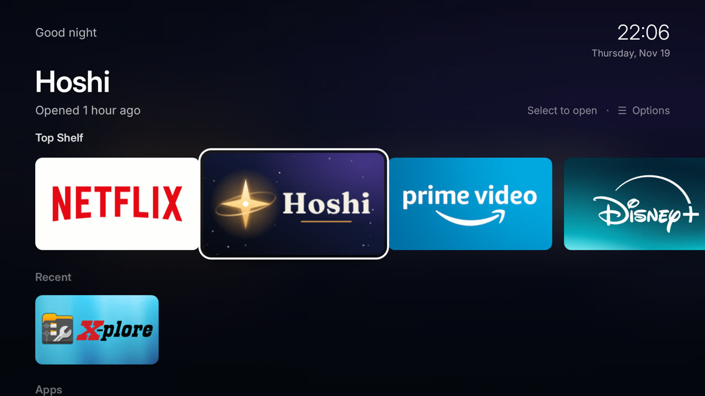
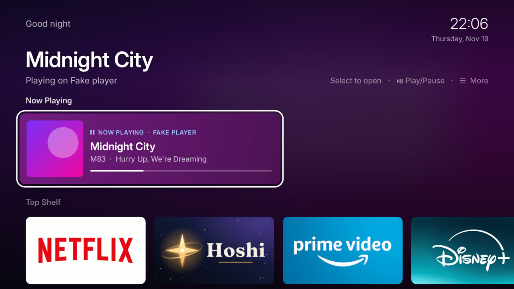
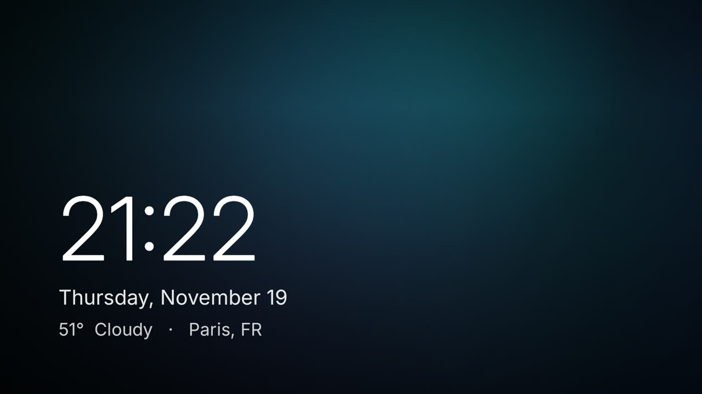
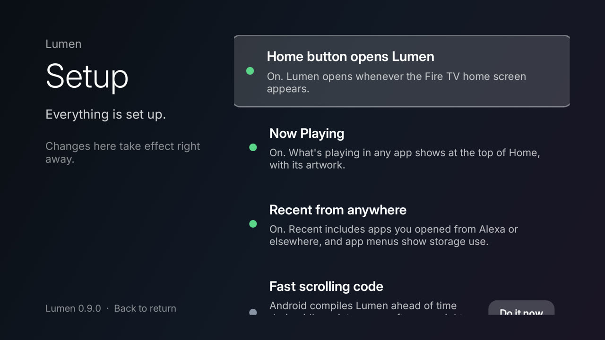

# Lumen

A fast, ad-free home screen for Fire TV and Android TV, inspired by Apple TV.



Most TV home screens put recommendations, ads and extra services between you and
what you wanted to watch. Lumen puts your apps first, keeps them where you put
them, and stays smooth on cheap hardware.

- **Now Playing**: when any app is playing music or a show, a card at the top shows its artwork, title and app,
  tints the background from the artwork, and opens or controls it (Select opens it, Play/Pause on the remote,
  Menu for next and previous). Reads only the player, never your notifications.
- **Top Shelf**: your apps, large, in the order you choose. Positions never move on their own.
- **Recent**: apps you opened lately that aren't on the Top Shelf. With usage access (the setup script turns
  it on) this includes apps opened from anywhere, such as Alexa or the Amazon home screen.
- **Groups**: make your own rows ("Kids", "Music", "Games"): Menu on any app → Add to a group. Apps in a
  group leave the Apps grid; groups can be renamed and reordered from the same menu.
- **New badge** on apps installed or updated in the last three days that you haven't opened yet.
- **Profiles**: each person gets their own Top Shelf, hidden apps, Recent row and background, and the
  greeting says their name. Lumen settings → Profile. With more than one profile, Lumen asks "Who's
  watching?" when the TV wakes (can be turned off).
- **Apps**: everything else in a grid. Hide anything you don't want to see.
- **Quick**: network status (Wi-Fi strength or Ethernet), display & sound, remotes, a **sleep timer**
  (pauses what's playing, then puts the TV to sleep), app management with free space, and settings.
- **App details**: the app menu shows version, last update and, with usage access, storage used.
- **Continue Watching** on devices that allow it (see below).
- **Info band**: a greeting and clock, the focused app's name, when you last opened it, and what the remote buttons do.
- **Backdrop that follows focus**: a soft blur of the focused app, or your own wallpapers.
- **Your layout, kept**: turn the Recent, Apps and Quick rows on or off; nothing autoplays.
- **Larger tiles and text**: an option for viewing from further away or with low vision.
- **Always clear where you are**: the focused tile lifts with a soft shadow and a ring drawn
  outside it (visible even on white artwork), and the title of the row you're in brightens. Deep in the
  Apps grid, the focused app's name stays at the top of the screen.
- **Motion with care**: tiles swing in slightly from the direction you moved, a soft light sweeps across
  the one you land on, and the tile grows as its app opens. All of it pauses while you hold a key, and
  Layout → Motion effects turns it off.
- **Feels like evening in the evening**: the backdrop takes a light warm tint in the morning, amber in the
  evening and a darker blue at night (Layout → Adapt colors to time of day).
- **Updates on the TV**: Lumen checks its GitHub releases once a day and, when there's a new version,
  downloads it, checks that it's Lumen and signed with the same key, and installs it after you confirm
  (Settings → Updates; the Lumen tile in the Quick row says when one is ready).
- **Back up and restore settings**: Settings → Back up settings saves your Top Shelf, groups, profiles and
  options to `Download/lumen-settings.json`; a new install restores from `/sdcard/Lumen/lumen-settings.json`.
- **Lumen's own menus**: settings, app options and choices open in a panel that slides in from the
  right, in the same typeface and focus style as Home, instead of the system dialogs. Back closes it.
- **Inter typeface**, and optional interface sounds (off by default; TVs often delay HDMI audio).
- **Ambient mode**: after a few idle minutes on Home (3 by default), the rows fade away and the background
  drifts slowly behind a large clock, the date, the weather and what's playing. Any key brings Home back
  (and does nothing else). The drift is updated 10 times a second, and the text moves a little every
  minute so nothing stays in one place on the screen.
- **Generated backgrounds**: Aurora, Dusk, Ocean and Geometry, drawn on the TV (nothing downloaded), with
  a new arrangement every day. Lumen settings → Background. Your own wallpapers still come first.
- **Weather (optional)**: type your city once (Lumen settings → Weather) and the temperature appears next
  to the greeting and in ambient mode.
- **Focus memory**: each row returns to the tile you left it on; Back and Home return to the top.
- **Setup and health**: one screen shows whether the Home button, fast scrolling code and wallpapers are set up, with the fix for each; one script sets it all up.
- **No ads, no sponsored rows, no account, no tracking.** Network use is limited to poster images for
  Continue Watching, a daily update check with GitHub (Settings → Updates turns it off), and, only if
  you turn it on, the weather from [Open-Meteo](https://open-meteo.com) (your city name once, to find it,
  then its coordinates every 30 minutes while Lumen is on screen).

| Now Playing | Ambient mode | Setup and health |
|---|---|---|
|  |  |  |

## Performance

On a **Fire TV Stick 4K Max** (Fire OS 8, MT8696, 2 GB), Lumen 0.9.0 with motion effects on, measured
with [`tools/bench.ps1`](tools/bench.ps1) (median of two consistent runs):

| | |
|---|---|
| Janky frames (across a row / down the page / D-pad held) | **0% / 0.36% / 0%** |
| Typical frame (p50) / slowest 1% (p99) | **5 ms / 10–12 ms** |
| Cold start | **285–310 ms** |
| Return to Home | **about 155 ms** (with "Don't keep activities" on; see below) |
| Memory on screen / while you watch something else | **84 MB / 70 MB** |

A run started straight after compiling measured 6–7% janky frames while the stick was still busy;
the two runs after it agreed with the table. Motion effects (tilt, light sweep) add about 1 ms to a
typical frame; Layout → Motion effects turns them off.

The stock Amazon home screen on the same stick: about 160–200 MB, and it stays running in the
background either way (the Home button opens it for an instant before Lumen takes over).

Where a frame's time goes on that stick (Lumen 0.3.3, before the motion effects; presses half a
second apart, about 2,900 frames, from `dumpsys gfxinfo framestats`). A frame has 16.7 ms:

| Stage | Typical | Notes |
|---|---|---|
| Main thread: key, animation, layout, recording | 0.5 ms | Focus change itself: 0.3–0.6 ms |
| Render thread: sync, GPU commands, hand-off | 2.7–2.9 ms | GPU commands 1.7 ms, queueing the frame 0.8 ms |
| GPU | 3.7–4.2 ms | About 2.5 ms is the fixed cost of writing a 1080p frame; tiles about 0.8 ms; the background about 0.2 ms |
| Whole frame (p50 / p90 / p99) | 3.9 / 5.1 / 9–11 ms | |

The slowest 1% are mostly the render thread waiting for the CPU or for the display's buffer queue
while other processes are busy (on the test stick Amazon's audio service used more than one of its
four cores the whole time). Hiding the info band, the text shadow, the focus shadow or ring, or the
background each changed the typical frame by 0.2 ms or less. With that background load, start
times vary a lot between runs: three runs of the same build gave cold starts of 331–419 ms.

Emulator comparison, measured with [`tools/bench.ps1`](tools/bench.ps1) on an Android 11 TV emulator at 1920×1080, 320 dpi
(the Fire TV Stick 4K Max's resolution and density), software GPU, same apps for both builds:

| | 0.1.1 | 0.2.0 |
|---|---|---|
| Janky frames, moving across a row | 79.8% | **0%** |
| Janky frames, moving down the page | 87.9% | **0%** |
| Janky frames, D-pad held down | 95.1% | **0%** |
| Slowest 1% of frames (p99) | 48–65 ms | **13–14 ms** |
| Cold start | 458 ms | **370 ms** |
| Return to Home (warm start) | 9 ms | 8 ms |
| Memory | 25 MB | 26 MB |

With the Apps grid repeated 9× (a large library), janky frames stay at 0.25–0.5% and p99 at 15 ms.
For comparison, the stock Fire TV home screen uses about 180 MB of memory on the 4K Max.

How:
- **One bitmap per tile.** Each app's banner (or icon and name) is rendered once into a
  bitmap at the exact tile size with rounded corners baked in, and cached on disk. A tile
  is a single lightweight view that draws one bitmap: no scaling, clipping or nested views.
- **One full-screen layer.** The backdrop is composited off the main thread with its
  darkening scrim baked in, so the GPU draws one full-screen image per frame instead of an
  image plus stacked gradients. The window background is dropped once it is covered.
- **No real-time shadows.** Focus is a 1.1× zoom (a GPU property, no redraw), a ring, and a
  shadow that is a pre-blurred alpha mask made once per tile size and drawn only for the
  focused tile. Animated elevation shadows are among the most expensive things a TV GPU can draw.
- **One virtualized list.** The whole page is a single RecyclerView; rows share a pool of
  tile views and only what's on screen (plus half a screen of margin) is bound.
- **Predictable scrolling.** The focused row always settles on the same line, rows only
  scroll near their edges, and animations shorten while a key is held so the screen keeps up.
- **Nothing slow on Home.** The app list lives in memory and in a small snapshot file;
  Lumen only rescans when Android reports a package change. Background work runs on
  low-priority threads. A baseline profile gets the hot path compiled ahead of time.

## Install (Fire TV)

1. On the Fire TV: Settings → My Fire TV → Developer options → turn on **ADB debugging** and **Apps from unknown sources**.
2. From the latest [release](../../releases/latest), download `lumen.apk` and the setup script for your
   computer (`setup.ps1` for Windows, `setup.sh` for macOS and Linux; also in `tools/`). With
   [ADB](https://developer.android.com/tools/releases/platform-tools) installed, run:

```powershell
./setup.ps1 -Device <fire-tv-ip> -Apk lumen.apk     # Windows
```

```sh
sh setup.sh <fire-tv-ip> lumen.apk                # macOS, Linux
```

It installs Lumen, makes the Home button open it (keeping any other accessibility services you use),
turns on Now Playing, usage access and updates, lets it read your wallpapers, then opens Lumen and compiles it
ahead of time. Choose **Allow** if the
TV asks about the computer. It's safe to run again, for example after an update.

On the TV, **Lumen → Setup and health** (Quick row → Lumen) shows the status of each step and the
command for anything that's missing.

Why a computer: Fire TV hides the settings Lumen needs, and Fire OS 8 refuses ADB connections made
from the TV itself (an app connecting to the TV's own ADB is disconnected immediately), so this can't
be done from Lumen.

<details><summary>The same steps by hand</summary>

```sh
adb connect <fire-tv-ip>:5555
adb install -r lumen.apk
adb shell settings put secure enabled_accessibility_services io.github.grimmmyy.lumen/io.github.grimmmyy.lumen.HomeWatcherService
adb shell settings put secure accessibility_enabled 1
adb shell cmd notification allow_listener io.github.grimmmyy.lumen/io.github.grimmmyy.lumen.NowPlayingService
adb shell appops set io.github.grimmmyy.lumen GET_USAGE_STATS allow
adb shell appops set io.github.grimmmyy.lumen REQUEST_INSTALL_PACKAGES allow
# open Lumen, wait about 10 seconds, then:
adb shell cmd package compile -m speed-profile -f io.github.grimmmyy.lumen
```

The accessibility command **replaces** the list of enabled accessibility services; the setup script
adds to it instead. Without the compile step, Android compiles Lumen's scrolling code ahead of time
during idle maintenance (often overnight); until then the first scrolls can stutter.
</details>

> **Check your model.** Some newer Fire TV devices (for example Fire TV Stick 4K Select and
> Fire TV Stick HD 2026) run Vega OS, which does not run Android apps. Lumen needs a Fire OS
> (Android-based) device.

## Make the Home button open Lumen

Fire OS (7 and later) won't let you pick a different default home screen, and its own launcher is
protected. Lumen does not remove or disable anything. Instead, a small accessibility service notices
when the Amazon home screen appears (Home button, boot, wake from standby) and opens Lumen over it.
It only sees which screen opened, only for the Amazon launcher, and cannot read screen content.

Fire TV hides the setting; the setup script above turns it on. To undo it:

```sh
adb shell settings put secure enabled_accessibility_services ""
```

**It can't trap you in a loop.** If Lumen crashes, Android stops the Home-button service until Lumen is
opened again. On top of that, Lumen has its own guard: 2 crashes within 5 minutes, or 6 Home redirects
within 15 seconds, switches it to safe mode, and the Home button goes to the Amazon home screen. Open Lumen
from Your Apps; once it has stayed on screen for 5 seconds, the Home button opens Lumen again. A factory
reset (hold **Back + Right** on the remote for 10 seconds) always restores the stock setup.

> **Force stop turns it off.** Android removes an app's accessibility service from the enabled list
> whenever the app is force-stopped (Settings → Applications → Lumen → Force stop, or `am force-stop`).
> Updating Lumen with `adb install -r` keeps it. If the Home button goes back to the Amazon home screen,
> run the setup script again.

> **Tip: leave "Don't keep activities" off.** Some "speed up your Fire Stick" guides turn on this
> developer option. It destroys every app's screen as soon as you leave it, so each return (to Lumen,
> Netflix, anything) rebuilds that screen from scratch instead of just showing it again: on a Fire TV
> Stick 4K Max, returning Home takes about 130 ms with it on. Lumen copes with it, but nothing gets
> faster with it on.
> Check with `adb shell settings get global always_finish_activities` (1 means on).

Need the Amazon home screen on purpose? Lumen settings → **Open Fire TV home** pauses the redirect for one minute.

**Optional:** Amazon's forced-update service has broken launcher workarounds in the past. You can switch it off
(normal updates still install from Settings):

```sh
adb shell pm disable-user --user 0 com.amazon.tv.forcedotaupdater.v2
```

## Using it

| Action | How |
|---|---|
| Open an app | Select its tile |
| Add, move, remove or hide an app | Long-press its tile, or press **Menu** (☰) |
| Back to the top | **Back** or **Home** |
| Choose which rows to show, or larger tiles | Quick → **Lumen** → Layout |
| Settings | Quick → **Lumen** |

### Wallpapers

Without wallpapers, the background is a soft blur of the focused app. To use your own:

```sh
adb shell mkdir -p /sdcard/Lumen/wallpapers
adb push default.jpg /sdcard/Lumen/wallpapers/
adb push netflix.jpg /sdcard/Lumen/wallpapers/com.netflix.ninja.jpg
# Lumen needs permission to read photos (or choose Allow in Lumen → Wallpapers):
adb shell pm grant io.github.grimmmyy.lumen android.permission.READ_EXTERNAL_STORAGE
```

- `default.jpg` shows for every app; `<package>.jpg` shows when that app is focused.
- PNG and WebP work too; 1920×1080 is ideal.
- Then Lumen → **Reload wallpapers and apps**.

On Android 13 and later, grant `android.permission.READ_MEDIA_IMAGES` instead.

### Continue Watching

This row reads Android's system Watch Next list. On Fire OS, the permission it needs is reserved
for Amazon's own system apps, so the row stays hidden there. It appears automatically on Android TV
and Google TV devices where apps publish to Watch Next.

## Permissions

| Permission | Why |
|---|---|
| `QUERY_ALL_PACKAGES` | List your installed apps |
| `INTERNET` | Poster images for Continue Watching, and weather if you turn it on |
| `READ_EPG_DATA` | Read Continue Watching (not grantable on Fire OS) |
| `READ_EXTERNAL_STORAGE` / `READ_MEDIA_IMAGES` | Optional: your wallpapers in `/sdcard/Lumen/wallpapers` |
| Accessibility service | Optional: make the Home button open Lumen (see above) |
| `ACCESS_NETWORK_STATE`, `ACCESS_WIFI_STATE` | Quick → Network: connected or not, Wi-Fi strength (never network names or location) |
| `REQUEST_INSTALL_PACKAGES` | Install Lumen updates from its GitHub releases (Android asks you to confirm each one) |
| Usage access (`PACKAGE_USAGE_STATS`) | Optional: Recent includes apps opened from anywhere; app menus show storage used |
| Notification access (`NowPlayingService`) | Optional: Now Playing. Android only shows apps' media players to a notification listener; Lumen never reads, keeps or shows notifications |

## Build

Requires JDK 17+ and the Android SDK (platform 34).

```sh
./gradlew assembleRelease
# app/build/outputs/apk/release/app-release.apk
```

Release builds are signed with the Lumen release key so installed copies can update: CI reads it from
repository secrets, and local builds from `~/.lumen/signing.properties` (keep that folder private and
backed up). Without it, a build from source is signed with your debug key; it installs fine but can't
update a release copy (Android requires the same key).

Each push to `main` builds an APK in GitHub Actions. To publish a release, run
`./tools/release.ps1 0.11.1`: it bumps the version, tags `v0.11.1` and pushes; CI builds, signs and
publishes the release with the setup scripts, and TVs pick it up within a day.

### Benchmark

```powershell
./tools/bench.ps1 -Serial <adb-serial> -Runs 5 [-Compile]
# Optional: a large library, the Apps grid repeated 8 extra times
adb -s <serial> shell setprop debug.lumen.stress 8
```

Reports cold and warm start, frame timing (jank %, p50–p99) for moving across a row, down the
page and with a key held, and memory. It force-stops Lumen and sends key presses, so don't run it
while someone is watching that TV.

## License

MIT. The bundled Inter typeface is under the SIL Open Font License ([licenses/Inter-OFL.txt](licenses/Inter-OFL.txt)).
